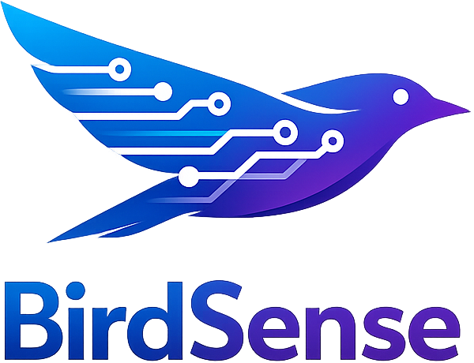

<p align="center">
  
</p>

<p align="center"><b>AI-powered bird species classification API</b></p>


<p align="center">
  <a href="https://github.com/birdsense/birdsense/actions/workflows/ci.yml"></a>
  <a href="LICENSE"></a>
  <a href="https://www.python.org/"></a>
  <a href="https://github.com/birdsense/birdsense"></a>
  <a href="https://birdsense.dev"></a>
</p>

---

## Features

- **REST API** - Upload images, get species with confidence scores
- **707 European Species** - Birder ViT Parallel EU-Common model (98% top-1 on the eu-common validation set), with lighter/faster models selectable
- **MQTT Events** - Publish detections with image URLs to your home automation
- **Image Storage** - Saved images served via API with listing endpoint
- **Web Dashboard** - Statistics, charts, and classifier testing
- **Docker Ready** - Easy deployment with Docker Compose

## Quick Start

```bash
git clone https://github.com/birdsense/birdsense.git
cd birdsense
docker compose up -d
```

- **Dashboard**: http://localhost:8080
- **API Docs**: http://localhost:5001/docs

## API

**Classify an image (file upload):**

```bash
curl -X POST http://localhost:5001/api/classify \
  -F "image=@bird.jpg" \
  -F "camera=garden"
```

**Classify an image (from URL):**

```bash
curl -X POST http://localhost:5001/api/classify \
  -d "image_url=https://example.com/bird.jpg" \
  -d "camera=birdbuddy" \
  -d "lang=nl"
```

**Response:**

```json
{
  "species_en": "European Robin",
  "species_nl": "Roodborst",
  "confidence": 92,
  "species": "Roodborst (92%)",
  "top_predictions": [...]
}
```

**List saved images:**

```bash
curl http://localhost:5001/api/images?limit=10
```

**Response:**

```json
{
  "images": [
    {
      "filename": "great_tit_1737550000.jpg",
      "species_en": "Great Tit",
      "timestamp": 1737550000,
      "url": "/images/great_tit_1737550000.jpg",
      "size": 245678
    }
  ],
  "total": 15,
  "count": 1
}
```

**Serve an image:**

```bash
# Direct image access
curl http://localhost:5001/images/great_tit_1737550000.jpg
```

## MQTT

BirdSense publishes bird detections to your MQTT broker when configured. Connect to your existing broker (like Home Assistant's Mosquitto) or use a standalone broker.

### Topics

| Topic | Description |
|-------|-------------|
| `birdsense/detections` | Published when a bird is detected |

### Payload

```json
{
  "species_en": "Great Tit",
  "species_nl": "Koolmees",
  "species": "Koolmees (85%)",
  "confidence": 85,
  "camera": "garden",
  "timestamp": 1706000000,
  "image_path": "/data/images/great_tit_1737550000.jpg",
  "top_predictions": [
    {"species_en": "Great Tit", "species_nl": "Koolmees", "confidence": 85},
    {"species_en": "Blue Tit", "species_nl": "Pimpelmees", "confidence": 12}
  ]
}
```

### Subscribe to Detections

```bash
# Using mosquitto-sub
mosquitto_sub -h homeassistant.local -t "birdsense/detections" -v

# Using HiveMQ Web Client
# Connect to your broker and subscribe to birdsense/#
```

### Command Line Test

```bash
# Publish a test message
mosquitto_pub -h homeassistant.local -t "birdsense/detections" \
  -m '{"species_en": "Great Tit", "species_nl": "Koolmees", "confidence": 92}'
```

### Home Assistant Integration

**MQTT Sensor - Add to `configuration.yaml`:**

```yaml
mqtt:
  sensor:
    - name: "Last Bird Detected"
      state_topic: "birdsense/detections"
      value_template: "{{ value_json.species_en }}"
      json_attributes_topic: "birdsense/detections"
      
    - name: "Bird Detection Confidence"
      state_topic: "birdsense/detections"
      value_template: "{{ value_json.confidence }}%"
      json_attributes_topic: "birdsense/detections"
      
    - name: "Bird Image"
      state_topic: "birdsense/detections"
      value_template: "{{ value_json.image_path }}"
      json_attributes_topic: "birdsense/detections"
```

**MQTT Binary Sensor for High Confidence:**

```yaml
mqtt:
  binary_sensor:
    - name: "Rare Bird Detected"
      state_topic: "birdsense/detections"
      value_template: >-
        
          ON
        
          OFF
        
      json_attributes_topic: "birdsense/detections"
```

**Automation Example:**

```yaml
automation:
  - alias: "Bird notification"
    trigger:
      platform: mqtt
      topic: "birdsense/detections"
    condition:
      - condition: template
        value_template: "{{ trigger.payload_json.confidence | int >= 80 }}"
    action:
      - service: notify.mobile_app
        data:
          title: "🐦 Bird detected!"
          message: "{{ trigger.payload_json.species_nl }} ({{ trigger.payload_json.confidence }}%)"
          data:
            image: >-
              http://homeassistant.local:5001{{ trigger.payload_json.image_path }}
```

## Home Assistant

**MQTT Sensor** - Add to `configuration.yaml`:

```yaml
mqtt:
  sensor:
    - name: "Last Bird Detected"
      state_topic: "birdsense/detections"
      value_template: "{{ value_json.species_en }}"
      json_attributes_topic: "birdsense/detections"
```

**REST Command** - Classify images from URL (e.g., BirdBuddy):

```yaml
rest_command:
  classify_bird:
    url: "http://birdsense:5001/api/classify"
    method: POST
    content_type: "application/x-www-form-urlencoded"
    payload: "image_url={{ image_url }}&camera={{ camera }}&lang=nl"
```

Usage in automation:
```yaml
service: rest_command.classify_bird
data:
  image_url: "{{ trigger.payload_json.image_url }}"
  camera: "birdbuddy"
```

**Shell Command** - Classify local images:

```yaml
shell_command:
  classify_bird: 'curl -s -X POST http://birdsense:5001/api/classify -F "image=@/config/www/snapshot.jpg"'
```

## Configuration

Set environment variables in `.env`:

| Variable | Description | Default |
|----------|-------------|---------|
| `MQTT_BROKER` | MQTT broker hostname | - |
| `MQTT_PORT` | MQTT broker port | `1883` |
| `MQTT_USERNAME` | MQTT username | - |
| `MQTT_PASSWORD` | MQTT password | - |
| `MIN_CONFIDENCE` | Minimum confidence % | `60` |
| `SAVE_IMAGES` | Save classified images | `true` |
| `IMAGE_DIR` | Directory for saved images | `/data/images` |
| `MAX_IMAGE_SIZE` | Max image size in bytes | `10485760` (10MB) |

## Dependency updates

Dependencies are kept current by [Renovate](https://docs.renovatebot.com/) (`renovate.json`). It covers:

- **pip**: `bridge/requirements.txt`, `web/requirements.txt`, `requirements-dev.txt` (ruff/pylint used by CI)
- **Docker**: base images in `bridge/Dockerfile` and `web/Dockerfile` (and `docker-compose.yml` if images are added)
- **GitHub Actions** in `.github/workflows/`
- **pre-commit** hook revisions in `.pre-commit-config.yaml`

How it behaves:

- Runs weekly (Monday before 06:00 Europe/Amsterdam); security fixes are opened immediately.
- Non-major updates are grouped per ecosystem (one PR for Python deps, one for Actions, one for pre-commit hooks; ruff in CI and pre-commit is updated together).
- The **ML stack** (torch, torchvision, transformers, birder, ...) gets its own PR, waits 7 days after a release, and is never auto-merged. Major ML updates and Python base image bumps (e.g. 3.11 to 3.12) only open after approval on the *Dependency Dashboard* issue.
- Loose ranges (`>=`) are pinned to exact versions, so every change arrives as an explicit PR.
- CI (`ci.yml`) runs on every PR: ruff/pylint plus a Docker build of both images, which installs the full requirements.

Non-major updates of Python deps, GitHub Actions and dev tooling are **auto-merged** once the required CI checks (Lint, Tests, Docker Build) pass on `main`'s branch protection. The ML stack and all major updates always need a manual merge.

## Releases

Every push to `main` that passes CI runs [semantic-release](https://semantic-release.gitbook.io/) (`.releaserc.json`). It reads the [Conventional Commits](https://www.conventionalcommits.org/) since the last tag and, when there is something to release, creates a `vX.Y.Z` tag and a GitHub Release with generated notes:

- `fix:` / `perf:` → patch, `feat:` → minor, `!` or `BREAKING CHANGE:` → major
- `chore:`, `docs:`, `style:`, `test:`, `ci:`, `refactor:` → no release

Renovate uses `fix(deps):` for runtime dependencies (app requirements, Docker base images), so those cut a patch release, and `chore(deps):` for dev tooling. Git tags are the source of truth for the version; `pyproject.toml`'s version is not bumped.

## License

MIT
